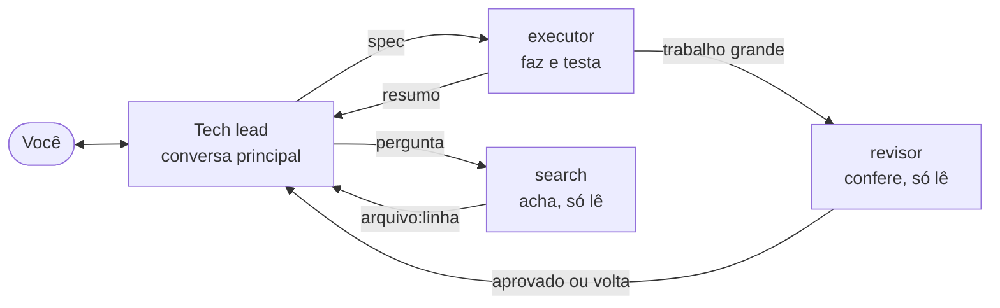

<div align="center">

# Modo Econômico

**Uma conversa decide, as outras executam. Cada papel roda no modelo que você escolher, inclusive local.**


</div>

Tudo que entra na conversa principal de um agente de código é relido a cada turno. Depois de algumas buscas e alguns arquivos abertos, ele gasta contexto e cota com material que não ajuda a decidir.

Quem decide não precisa ver o trabalho braçal, só o resultado. O `/economico` transforma a conversa em tech lead: ela decide, escreve a spec e revisa. O resto vai para subagentes com contexto próprio, em paralelo, e só o resumo volta.



| Papel | O que faz | Edita arquivo? | Padrão no Claude Code |
|---|---|---|---|
| Tech lead (a conversa) | Decide, escreve a spec, revisa, faz o que exige gosto | Sim | O modelo que você abrir |
| `executor` | Aplica o que já foi decidido e testa | Sim | `opus`, esforço `max` |
| `revisor` | Confere trabalho grande contra a spec | Não | `opus`, esforço `max` |
| `search` | Acha onde está cada coisa | Não | `sonnet` |

## Instalar

```bash
git clone https://github.com/kamusmg/modo-economico
cd modo-economico
python instalar.py claude      # ou: opencode, codex
```

Sem git, use **Code → Download ZIP** e rode só a última linha dentro da pasta.

Depois abra a ferramenta e ligue o modo:

| Ferramenta | Liga | Desliga |
|---|---|---|
| Claude Code | `/economico` | `/normal` |
| OpenCode | `/economico` | `/normal` |
| Codex | `$economico` | `$normal` |

Se você já tiver um arquivo com o mesmo nome, o instalador guarda o seu como `.bak-<data>` antes de escrever. Precisa de Python 3.9 ou mais novo, sem nenhuma dependência. Sem Python, peça para a própria IA: "leia este README e instale para mim".

Para deixar sempre ligado, cole o texto de `comandos/economico.md` no arquivo de instruções globais da ferramenta (`CLAUDE.md` ou `AGENTS.md`), sem a última linha.

## Trocar os modelos

Só o `modelos.ini` muda. Edite e rode o instalador de novo:

```ini
[claude]
executor = sonnet
revisor = sonnet
search = haiku
esforco_executor =
esforco_revisor =
esforco_search =
```

Vazio significa usar o mesmo modelo da conversa principal. Os padrões de `[claude]` gastam bastante, porque foram pensados para o plano Max. No Claude Pro ou na API, comece pelo exemplo acima. Evite trocar o modelo da conversa principal no meio do trabalho: o cache é por modelo e a troca reprocessa o contexto inteiro.

## Usar com IA local e outros modelos

| | OpenCode | Claude Code | Codex |
|---|---|---|---|
| Modelo diferente por papel | Sim | Sim | Sim |
| Nuvem e local na mesma sessão | **Sim** | Não, um endpoint por sessão (só com um roteador na frente) | Não, um provedor por sessão |
| Modelo local | Nativo | Via Ollama, sem suporte oficial da Anthropic | Nativo, com `--oss` |
| Papel só leitura | Edição negada | Sem ferramentas de edição | Só por instrução |

Quem quer misturar, com a conversa na nuvem e os executores no PC, deve usar o **OpenCode**. Nos papéis só leitura o terminal continua liberado, para rodar `git diff` e testes, então ali a garantia é a instrução.

**Antes de escolher o modelo local:**

- Ele precisa ter suporte a *tool calling*.
- Use pelo menos **64k de contexto**. O padrão do Ollama pode ser só 4k: `OLLAMA_CONTEXT_LENGTH=64000 ollama serve`.
- Com uma GPU só, use o mesmo modelo em todos os papéis ou modelos que caibam juntos na VRAM. Se não couberem, o Ollama descarrega um para carregar o outro a cada delegação.
- `OLLAMA_NUM_PARALLEL` vem em 1, então executores "em paralelo" entram em fila. Aumentar consome mais memória, porque ela escala com `NUM_PARALLEL × CONTEXT_LENGTH`.

<details>
<summary><strong>OpenCode com Ollama</strong></summary>

Em `~/.config/opencode/opencode.json`:

```json
{
  "$schema": "https://opencode.ai/config.json",
  "provider": {
    "ollama": {
      "npm": "@ai-sdk/openai-compatible",
      "name": "Ollama",
      "options": { "baseURL": "http://localhost:11434/v1" },
      "models": { "qwen3.5": { "name": "qwen3.5", "tool_call": true } }
    }
  }
}
```

No `modelos.ini` (para LM Studio, a porta é `1234` e o prefixo é o nome que você der ao provedor):

```ini
[opencode]
executor = ollama/qwen3.5
revisor = ollama/qwen3.5
search = ollama/qwen3.5
```

Depois: `python instalar.py opencode`. A conversa principal continua no modelo que você selecionar, na nuvem ou local.

</details>

<details>
<summary><strong>Claude Code com Ollama</strong></summary>

Coloque os nomes do Ollama no `modelos.ini` e deixe o esforço vazio:

```ini
[claude]
executor = qwen3.5
revisor = qwen3.5
search = qwen3.5
esforco_executor =
esforco_revisor =
esforco_search =
```

Depois:

```bash
python instalar.py claude
ollama launch claude --model qwen3.5
```

Para outro servidor compatível com a API da Anthropic, defina `ANTHROPIC_BASE_URL`, `ANTHROPIC_AUTH_TOKEN` e `ANTHROPIC_DEFAULT_HAIKU_MODEL`, que o Claude Code usa em tarefas de fundo. A Anthropic não dá suporte a modelos que não sejam Claude. Quem documenta este caminho é o Ollama.

</details>

<details>
<summary><strong>Codex com modelo local</strong></summary>

```bash
python instalar.py codex
codex --oss --local-provider ollama -m gpt-oss:120b
```

Também funciona com `ollama launch codex`. Os papéis podem usar modelos diferentes, sempre no provedor da sessão.

</details>

**Outra ferramenta?** Os papéis são Markdown puro. Peça para a sua IA: "leia `papeis/` e `comandos/` e crie o equivalente na minha ferramenta". Ou escreva um adaptador em `instalar.py`: uma função que devolve `destino → conteúdo`, registrada em `ADAPTADORES`, mais uma seção no `modelos.ini`.

## Personalizar

```text
modo-economico/
├── modelos.ini        qual modelo faz cada papel
├── papeis/            o que cada subagente é e como responde
├── comandos/          o texto que liga e desliga o modo
├── instalar.py        traduz tudo para o formato de cada ferramenta
└── test_instalar.py   python -m unittest
```

Mudou o texto de um papel ou comando? Rode o instalador de novo. Para criar um papel, adicione um arquivo em `papeis/`, uma linha em cada seção do `modelos.ini` e cite o nome em `comandos/economico.md`.

Para remover, apague os arquivos que o instalador listou:

| Ferramenta | Arquivos |
|---|---|
| Claude Code | `~/.claude/agents/{executor,revisor,search}.md` e `~/.claude/commands/{economico,normal}.md` |
| OpenCode | `~/.config/opencode/agents/{executor,revisor,search}.md` e `~/.config/opencode/commands/{economico,normal}.md` |
| Codex | `~/.codex/agents/{executor,revisor,search}.toml` e `~/.agents/skills/{economico,normal}/` |

## O que foi testado

| Ferramenta | Versão | Conferido |
|---|---|---|
| Claude Code | 2.1.319 | Comando carregado; cada papel chega ao modelo configurado; papéis só leitura sem ferramenta de edição |
| OpenCode | 1.19.5 | Comando carregado; conversa e executor em provedores diferentes na mesma sessão; edição negada |
| Codex | 0.167.0 | Agentes e comando carregados; a delegação em si não foi exercitada |

Os testes usaram um servidor falso que registra o modelo pedido em cada chamada. Nenhum modelo local real foi rodado, então velocidade e qualidade dependem do modelo que você escolher.

## Licença

MIT. Pode copiar, mudar e redistribuir.
