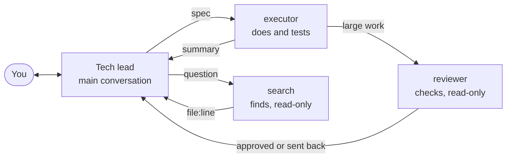

<div align="center">

# Modo Econômico

**One conversation decides, the others execute. Each role runs on the model you choose, including local ones.**


**English** · [Português](README.pt-BR.md)

</div>

Everything that enters a coding agent's main conversation is reread on every turn. After a few searches and opened files, it spends context and quota on material that does not help it decide.

Whoever decides does not need to see the legwork, only the result. "Modo Econômico" (Portuguese for *economy mode*) turns the conversation into a tech lead: it decides, writes the spec, and reviews. Everything else goes to subagents with their own context, in parallel, and only the summary comes back.



| Role | What it does | Edits files? | Plugin default (Claude Code) |
|---|---|---|---|
| Tech lead (the conversation) | Decides, writes the spec, reviews, does anything that takes taste | Yes | Whichever model you open |
| `executor` | Applies what was decided and tests it | Yes | `sonnet` |
| `reviewer` | Checks large work against the spec | No | `sonnet` |
| `search` | Finds where things are | No | `haiku` |

## Install

### Claude Code plugin

No Python needed. Inside Claude Code:

```text
/plugin install modo-economico --marketplace kamusmg/modo-economico
```

From a terminal:

```bash
claude plugin marketplace add kamusmg/modo-economico
claude plugin install modo-economico@modo-economico
```

Then turn it on and off in any conversation:

| Action | Command |
|---|---|
| On | `/modo-economico:on` |
| Off | `/modo-economico:off` |

To update: `claude plugin update modo-economico@modo-economico`. To remove: `claude plugin uninstall modo-economico@modo-economico`.

The plugin's models are fixed. To choose your own, or to use OpenCode or Codex, use the installer. Do not install both in Claude Code.

### Installer: choose your models, or use OpenCode or Codex

```bash
git clone https://github.com/kamusmg/modo-economico
cd modo-economico
python instalar.py claude      # or: opencode, codex
```

| Tool | On | Off |
|---|---|---|
| Claude Code | `/economico` | `/normal` |
| OpenCode | `/economico` | `/normal` |
| Codex | `$economico` | `$normal` |

The installer needs Python 3.9 or newer and has no dependencies. If a file with the same name already exists, it is saved as `.bak-<date>` first. The installer's prompts are in Portuguese, so its confirmation message appears in Portuguese, and its review role is named `revisor`. The plugin is fully in English.

To keep the mode always on, paste the text of `comandos/economico.md`, minus its last line, into your tool's global instructions file (`CLAUDE.md` or `AGENTS.md`).

## Change the models

This applies to the installer. Only `modelos.ini` changes (*esforco* means reasoning effort). Edit it and run the installer again:

```ini
[claude]
executor = sonnet
revisor = sonnet
search = haiku
esforco_executor =
esforco_revisor =
esforco_search =
```

Empty means the role uses the same model as the main conversation. The default `[claude]` section of the installer uses `opus` at maximum effort, which is meant for the Max plan. On Claude Pro or the API, start with the example above. Avoid switching the main conversation's model mid-task: the cache is per model, and switching reprocesses the entire context.

## Use local and other models

| | OpenCode | Claude Code | Codex |
|---|---|---|---|
| Different model per role | Yes | Yes | Yes |
| Cloud and local in the same session | **Yes** | No, one endpoint per session (only with a router in front) | No, one provider per session |
| Local model | Native | Via Ollama, not officially supported by Anthropic | Native, with `--oss` |
| Read-only role | Edits denied | No edit tools | By instruction only |

To mix them, with the conversation in the cloud and the executors on your machine, use **OpenCode**. Read-only roles keep the terminal so they can run `git diff` and tests, so the guarantee there is the instruction.

**Before choosing a local model:**

- It must support *tool calling*.
- Use at least **64k of context**. Ollama's default may be only 4k: `OLLAMA_CONTEXT_LENGTH=64000 ollama serve`.
- With one GPU, use the same model for every role or models that fit in VRAM together. Otherwise Ollama unloads one to load the other on every delegation.
- `OLLAMA_NUM_PARALLEL` defaults to 1, so "parallel" executors queue up. Raising it uses more memory, which scales with `NUM_PARALLEL × CONTEXT_LENGTH`.

<details>
<summary><strong>OpenCode with Ollama</strong></summary>

In `~/.config/opencode/opencode.json`:

```json
{
  "$schema": "https://opencode.ai/config.json",
  "provider": {
    "ollama": {
      "npm": "@ai-sdk/openai-compatible",
      "name": "Ollama",
      "options": { "baseURL": "http://localhost:11434/v1" },
      "models": { "qwen3.5": { "name": "qwen3.5", "tool_call": true } }
    }
  }
}
```

In `modelos.ini` (for LM Studio, the port is `1234` and the prefix is whatever you name the provider):

```ini
[opencode]
executor = ollama/qwen3.5
revisor = ollama/qwen3.5
search = ollama/qwen3.5
```

Then: `python instalar.py opencode`. The main conversation stays on whichever model you select, cloud or local.

</details>

<details>
<summary><strong>Claude Code with Ollama</strong></summary>

Put the Ollama names in `modelos.ini` and leave effort empty:

```ini
[claude]
executor = qwen3.5
revisor = qwen3.5
search = qwen3.5
esforco_executor =
esforco_revisor =
esforco_search =
```

Then:

```bash
python instalar.py claude
ollama launch claude --model qwen3.5
```

For another server compatible with the Anthropic API, set `ANTHROPIC_BASE_URL`, `ANTHROPIC_AUTH_TOKEN`, and `ANTHROPIC_DEFAULT_HAIKU_MODEL`, which Claude Code uses for background tasks. Anthropic does not support non-Claude models. Ollama documents this path.

</details>

<details>
<summary><strong>Codex with a local model</strong></summary>

```bash
python instalar.py codex
codex --oss --local-provider ollama -m gpt-oss:120b
```

`ollama launch codex` also works. Roles can use different models, always on the session's provider.

</details>

**Another tool?** The roles are plain Markdown. Ask your AI: "read `papeis/` and `comandos/` and create the equivalent for my tool". Or write an adapter in `instalar.py`: a function that returns `destination → content`, registered in `ADAPTADORES`, plus a section in `modelos.ini`.

## Customize

```text
modo-economico/
├── plugin/            the Claude Code plugin, in English
├── modelos.ini        which model does each role
├── papeis/            what each subagent is and how it answers
├── comandos/          the text that turns the mode on and off
├── instalar.py        translates it all into each tool's format
└── test_*.py          python -m unittest
```

Changed a role or command? Run the installer again. To add a role, add a file in `papeis/`, a line in each section of `modelos.ini`, and mention its name in `comandos/economico.md`. The plugin is a separate translation, so change it in `plugin/` too.

To remove what the installer added, delete the files it listed:

| Tool | Files |
|---|---|
| Claude Code | `~/.claude/agents/{executor,revisor,search}.md` and `~/.claude/commands/{economico,normal}.md` |
| OpenCode | `~/.config/opencode/agents/{executor,revisor,search}.md` and `~/.config/opencode/commands/{economico,normal}.md` |
| Codex | `~/.codex/agents/{executor,revisor,search}.toml` and `~/.agents/skills/{economico,normal}/` |

## What was tested

| Tool | Version | Checked |
|---|---|---|
| Claude Code plugin | 2.1.319 | Installed into a clean config; command loaded; `executor` on `sonnet` with the conversation on `opus`; `search` on `haiku` with no edit tools |
| Claude Code installer | 2.1.319 | Command loaded; each role reaches its configured model; read-only roles have no edit tools |
| OpenCode | 1.19.5 | Command loaded; conversation and executor on different providers in the same session; edits denied |
| Codex | 0.167.0 | Agents and command loaded; delegation itself was not exercised |

The tests used a fake server that records the model requested in each call. No real local model was run, so speed and quality depend on the model you choose.

## License

MIT. Copy it, change it, redistribute it.
